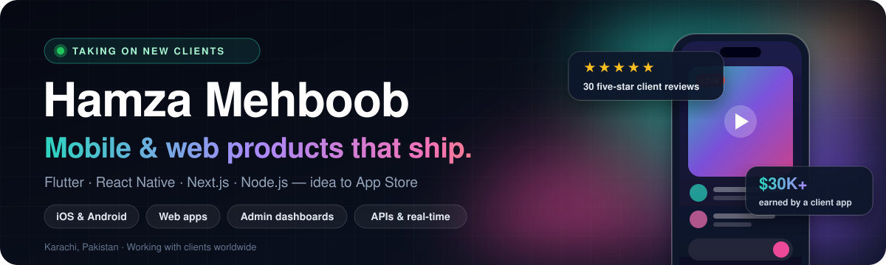
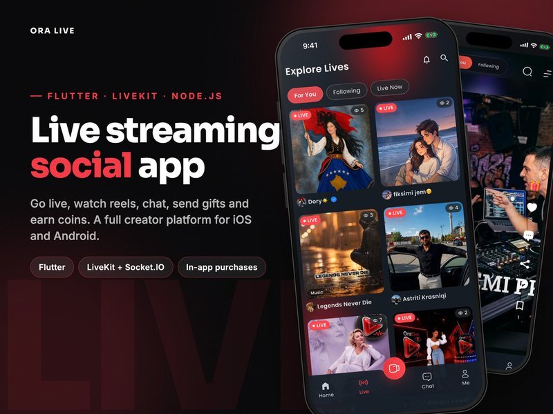
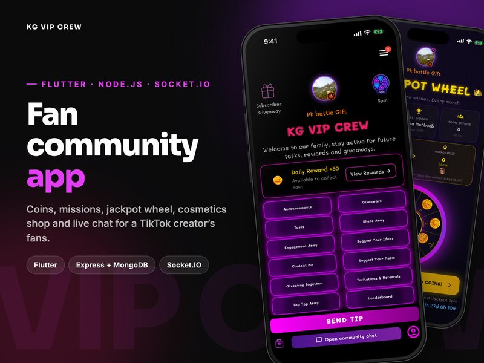
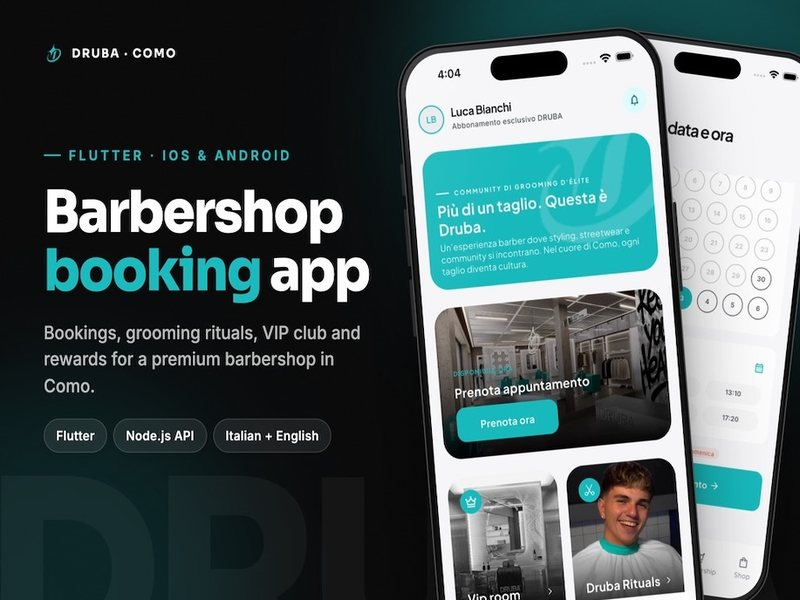
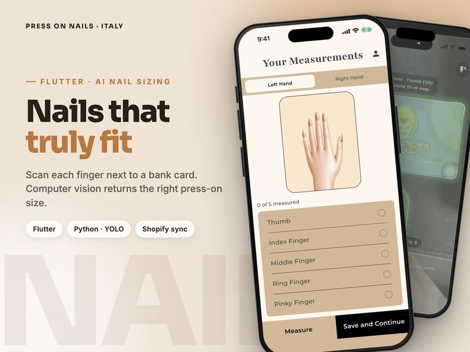
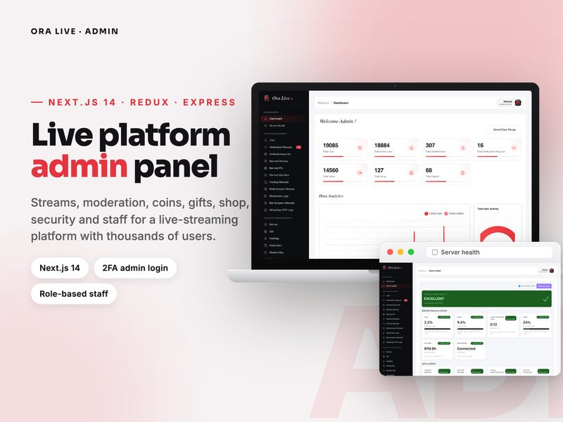
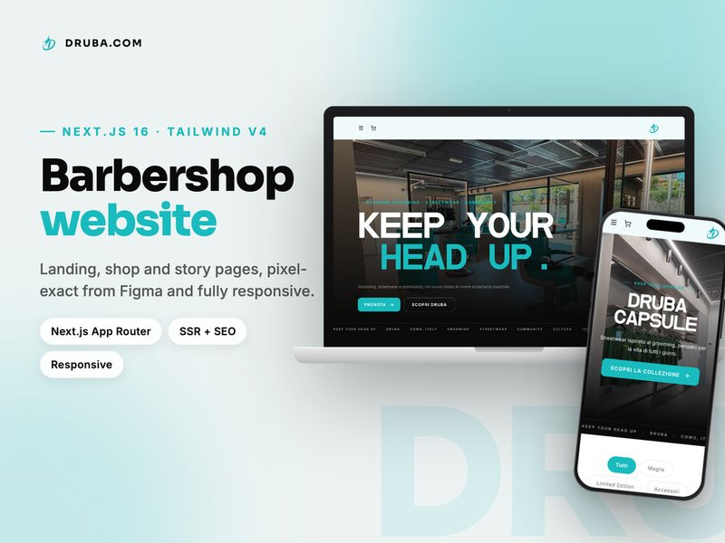

 

 

## 👋 About me

I'm **Hamza**, a software consultant from **Karachi, Pakistan 🇵🇰**. I lead a senior team that takes **mobile, web and desktop products** from idea to launch, and I stay hands-on in the code on every project.

- 💼 **Lead Software Engineer** at [Vision Scale Labs](https://visionscale-labs.com), plus my own consultancy for client work
- 🌍 **30+ projects** shipped for clients in the **US, Canada, Germany, Italy, South Africa** and beyond
- ⭐ **Every Fiverr review to date is 5 stars**, from one-day bug fixes to multi-month builds
- ⚡ Send me a few lines about your idea and I'll reply **within 24 hours** with questions, a rough plan and an estimate

## 🛠️ What I can build for you

<table>
  <tr>
    <td width="50%" valign="top">
      <h4>📱 Mobile apps</h4>
      Cross-platform <b>Flutter</b> and <b>React Native</b> apps for iOS and Android, built pixel-perfect from your Figma designs.
    </td>
    <td width="50%" valign="top">
      <h4>🌐 Web apps &amp; websites</h4>
      Fast, SEO-friendly sites and web apps with <b>React</b>, <b>Next.js</b> and the MERN stack. WordPress when a content site fits better.
    </td>
  </tr>
  <tr>
    <td width="50%" valign="top">
      <h4>📊 Admin dashboards &amp; CRMs</h4>
      Back-office tools that run your business day to day: users, orders, reports, moderation and roles, all on the same API as your app.
    </td>
    <td width="50%" valign="top">
      <h4>⚙️ Backends &amp; APIs</h4>
      <b>Node.js</b>, Express and Fastify APIs on MongoDB or PostgreSQL, with payments, auth, push notifications and third-party integrations.
    </td>
  </tr>
  <tr>
    <td width="50%" valign="top">
      <h4>🎥 Real-time &amp; live features</h4>
      Live streaming, real-time chat, gifting and in-app coin economies with <b>LiveKit</b> and <b>Socket.IO</b>.
    </td>
    <td width="50%" valign="top">
      <h4>🚀 Store publishing &amp; app rescue</h4>
      App Store and Google Play releases, review-rejection fixes, and taking over projects that a previous developer left unfinished.
    </td>
  </tr>
</table>

## 🌟 Featured client work

<table>
  <tr>
    <td width="50%" valign="top">
      
      <h3>📺 OraLive</h3>
      A TikTok-style creator platform with live streams, short videos, chat and a coin economy where fans send gifts and creators withdraw real earnings. <b>76 screens, 12 languages, and $30K+ in revenue so far.</b>
        
      
      
       Flutter · LiveKit · Node.js · Socket.IO · MongoDB
    </td>
    <td width="50%" valign="top">
      
      <h3>💎 KG VIP CREW</h3>
      A fan community app for a TikTok creator. Members chat in real time, earn coins through daily rewards and a jackpot wheel, unlock cosmetics, enter giveaways and climb the leaderboard.
        
      
      
       Flutter · Node.js · Socket.IO · MongoDB · Firebase
    </td>
  </tr>
  <tr>
    <td width="50%" valign="top">
      
      <h3>💈 Druba: booking &amp; loyalty</h3>
      A branded app for a premium barbershop in Como, Italy. Clients pick a ritual and a barber, book a real slot and pay in the app, then earn points, rewards and VIP perks. Bilingual (Italian and English).
        
      
       Flutter · Node.js · Fastify · MongoDB
    </td>
    <td width="50%" valign="top">
      
      <h3>💅 Press On Nails: AI sizing</h3>
      An Italian nail brand was losing sales to wrong sizes. This app measures each nail with the phone camera using a <b>YOLO computer-vision model</b> and sends the sizes straight to their Shopify store.
        
      
       Flutter · Python · YOLO · Shopify · Firebase
    </td>
  </tr>
  <tr>
    <td width="50%" valign="top">
      
      <h3>🛡️ OraLive Admin</h3>
      The back-office for the OraLive platform. Operators watch live and flagged streams in real time, moderate chat, manage coins and gifts, and run reports, with 2FA and role-based staff access.
        
      
       Next.js · Redux Toolkit · Node.js · MongoDB
    </td>
    <td width="50%" valign="top">
      
      <h3>🌐 Druba website</h3>
      The public site for the Druba barbershop and streetwear brand, built pixel-exact from the client's Figma, with a shop, product catalogue and story pages, and fully responsive.
        
      
       Next.js · React · TypeScript · Tailwind
    </td>
  </tr>
</table>

**More shipped work:** [Confessional Prayer Bible](https://apps.apple.com/us/app/confessional-prayer-bible/id6468518044) (iOS & Android) · [Safaa's Islamic Affirmations](https://play.google.com/store/apps/details?id=com.safaapp.safa_app) (Android) · [Beauté Concept](https://www.beaute-concept.ae/) (a Dubai aesthetic clinic) · KG VIP CREW Admin · Druba CRM · Private Prime finance website · iMart e-commerce suite → **[see every project on my portfolio](https://www.hamzamehboob.me/)**

## 💬 What clients say

<table>
  <tr>
    <td width="50%" valign="top">
      ⭐⭐⭐⭐⭐ 
      <i>"This is the only guy you need to publish your app properly. He is professional, polite, and definitely knows his work. I'm going to work with you again for sure!"</i>
        — <b>bizzinnova</b> · 🇵🇰 Pakistan · Fiverr
    </td>
    <td width="50%" valign="top">
      ⭐⭐⭐⭐⭐ 
      <i>"Amazing work from Hamza! He fixed the previous issue the past developer created and published the app on time."</i>
        — <b>maituz</b> · 🇿🇦 South Africa · Fiverr
    </td>
  </tr>
  <tr>
    <td width="50%" valign="top">
      ⭐⭐⭐⭐⭐ 
      <i>"The frontend looks clean, modern, and very well-polished. The UI/UX is thoughtfully designed, animations are smooth… Highly recommended!"</i>
        — <b>johnyy43</b> · 🇩🇪 Germany · Fiverr
    </td>
    <td width="50%" valign="top">
      ⭐⭐⭐⭐⭐ 
      <i>"They quickly identified the issue and proposed an effective solution. Throughout the project, they maintained clear communication and demonstrated excellent problem-solving skills."</i>
        — <b>dmcgravey</b> · 🇺🇸 United States · Fiverr
    </td>
  </tr>
</table>

<a href="https://www.fiverr.com/hamzaamehboob"><b>Read all 30 five-star reviews on Fiverr →</b></a>

## 🧭 How we'll work together

| 🔍 1. Discover | 🎨 2. Design | ⚙️ 3. Build | 🚀 4. Launch |
|:---|:---|:---|:---|
| We talk through your goals and users. You get a clear scope, timeline and estimate before any code is written. | Wireframes and UI in Figma, so you can see and feel the product before it's built. | Clean architecture and tested code, delivered in milestones with regular updates. | App Store, Google Play or web release, then ongoing support, updates and improvements. |

## 🧰 Tech stack

<table>
  <tr>
    <td><b>Mobile</b></td>
    <td></td>
  </tr>
  <tr>
    <td><b>Web</b></td>
    <td></td>
  </tr>
  <tr>
    <td><b>Backend</b></td>
    <td></td>
  </tr>
  <tr>
    <td><b>Data</b></td>
    <td></td>
  </tr>
  <tr>
    <td><b>Tools</b></td>
    <td></td>
  </tr>
</table>

## 📈 GitHub activity

<picture>
  <source media="(prefers-color-scheme: dark)" srcset="https://raw.githubusercontent.com/hamxamehboob/hamxamehboob/output/github-snake-dark.svg">
  <source media="(prefers-color-scheme: light)" srcset="https://raw.githubusercontent.com/hamxamehboob/hamxamehboob/output/github-snake.svg">
  
</picture>

<b>🧪 Open-source playground</b>

 

| Project | What it is | Tech |
|---|---|---|
| [🛒 Ecommerce App](https://github.com/hamxamehboob/Ecommerce-App) | Shopping app with cart and checkout flow | Flutter · Dart |
| [💬 Chat App](https://github.com/hamxamehboob/chat-app) | Real-time messaging | Flutter · Firebase |
| [🍲 Recipe App](https://github.com/hamxamehboob/recipe-app) | Explore and search a wide range of recipes | Flutter · Dart |
| [🌦️ Weather App](https://github.com/hamxamehboob/weatherAPP) | Live weather from a public API | Flutter · REST |
| [❌⭕ Tic-Tac-Toe](https://github.com/hamxamehboob/Tik_tac_toe_game) | Classic game with custom game logic | Flutter · Dart |

---

### 🤝 Have a project in mind?

Tell me what you want to build. I'll reply within 24 hours with questions, a rough plan and an estimate.

Also on <a href="http://www.youtube.com/@hamza_mehboob">YouTube</a> · <a href="https://web.facebook.com/hamxa2003/">Facebook</a>
  

